# PCF build setup validation

Acceptance runs for the PCF build setup described in [PCF projects in Visual Studio](pcf-projects.md), made with commit `d69f1622c0eb84025e7652e98da6719d6f7632be` in the Visual Studio Experimental instance against real PAC-generated projects and the real `pcf-scripts` pipeline.

## How the runs were made

- `scripts/RunAll.ps1` ran each scenario in its own Visual Studio Experimental instance, driving it through DTE automation and UI Automation: commands are executed, dialog controls are invoked, and text is read back from the Error List, the Build output, the notification bar and the dialogs. No mouse or keyboard input was simulated.
- Fixtures are copies of one `pac pcf init` field-template project. Their npm scripts print `XTNODE <project> <version> <path>`, so the build output shows which Node.js Microsoft's npm commands really ran under.
- Scenarios 3 and 7, and the environment log, were run again after two defects in the test scripts themselves were fixed (a variable name clash and a missing `Get-FileHash`). The extension build was the same for every scenario.
- This machine's registered Windows PATH contains Node.js, and it was not changed. Where a scenario needs a machine without it, Visual Studio was started with `XRMTOOLS_PCF_WINDOWS_PATH`, which the extension reads in place of the registered PATH, and with `FNM_DIR` pointing at a copy of the fnm directory made of junctions. Those scenarios are marked "simulated" below.

## Acceptance matrix

| # | Scenario | Result | What was observed | Not covered |
| --- | --- | --- | --- | --- |
| 1 | Normal Windows launch, usable Node.js/npm, wizard defaults, build | Verified | Wizard shows `Node.js v22.15.0 with npm 10.9.2 — Visual Studio's PATH`, setup options collapsed, install checked. Create installed dependencies; Build succeeded without another install. | |
| 2 | Normal launch, fnm installed, Node.js/npm not on the inherited PATH | Verified, simulated PATH | With an fnm default the first Rebuild succeeded with no action. With two fnm versions and no default the build stopped with `XTPCF002`; the notification opened setup; choosing v24.21.0 made Rebuild succeed with that version. A new session remembered the choice; removing the installation was reported on the next build. | fnm that is not on Visual Studio's PATH and is found only through its install folders. |
| 3 | Fresh checkout, first Build | Verified | Microsoft's install ran once; build succeeded; `package-lock.json` unchanged. | |
| 4 | Separate fresh checkout, first Rebuild | Verified | `Xrm Tools: npm dependencies are not installed yet; running Microsoft's npm restore before Clean.` One install, then Microsoft's clean, build and rebuild. | |
| 5 | No compatible Node.js installation | Verified, simulated | Build stopped with `XTPCF001`; the notification, the setup dialog and the wizard all say what is missing and offer Browse, Check again and Get Node.js. | Get Node.js was not clicked (it opens a browser). Installing Node.js and then choosing Check again was not performed. |
| 6 | Installation failure, project preserved, retry after correction | Verified for an unreachable registry | Wizard kept the project, named the cause (`ECONNREFUSED`) and offered Retry setup and Open project. Retry succeeded after the npm configuration was corrected. Open project showed the incomplete-setup notification, and Set up finished it. | Registry authentication failure and lock-file mismatch are covered by unit tests only. |
| 7 | Cancellation | Verified for setup | Cancel ended npm and its child processes within 4 s, left no lock file, reported "Not installed", and a second Set up succeeded with `package-lock.json` unchanged. A second project canceled later, with `pcf-scripts` already on disk, was finished by the next Build, which reran Microsoft's restore. | Cancel in the wizard during install is covered by a unit test only. Canceling a Visual Studio build while Microsoft's `npm install` runs was not exercised. |
| 8 | Unchanged build avoids installation | Verified | After scenarios 1, 3, 4 and 7 the next Build ran neither `npm install` nor `pcf-scripts`, in 2 to 4 s. | |
| 9 | Concurrent setup and build for one project | Verified | Setup during a build is refused with "A build is running" and starts no npm. A build while another process holds the project's setup lock stops with `XTPCF006` and leaves `node_modules` alone; it succeeds after the lock is released. While this instance's own setup dialog is installing, a build request sent to Visual Studio from another process was not acted on. | The second Visual Studio was represented by a process holding the lock file, not by a real second instance. |
| 10 | Two projects with different Node.js requirements | Verified as a stated limitation | `P22` built with v22.15.0. `P24` stopped with `XTPCF007` before any npm script ran, and built with v24.21.0 once `P22` was unloaded, in the same session. | Different versions in one build are not supported. |
| 11 | Explicit non-npm configuration | Verified for `packageManager: pnpm` | Build and Rebuild stopped with `XTPCF004`; no file changed, no `package-lock.json` or `node_modules` created; setup explains and installs nothing. | Detection from lock files alone, and conflicting lock files, are covered by unit tests only. |
| 12 | Relaunch | Not needed, so not implemented | In one session that started without Node.js, three parallel projects rebuilt with v22.15.0, then v24.21.0, then v22.15.0 as the selection changed. Two of Visual Studio's MSBuild worker processes stayed alive across all three builds. | |

Not tested at all: Visual Studio 2022, Build Selection for a single project, a solution that mixes PCF with other project types, and a live `pac pcf push`.


## Evidence

Each log below is the unedited output of the script that drove Visual Studio, except that the user profile folder is written as `%USERPROFILE%`. Build output files named in the logs, and the scripts, are in [pcf-build-setup-evidence](pcf-build-setup-evidence).

Screenshots were captured by the scripts. Their text was compared with the logs using Windows OCR; nobody has looked at them. The Xrm Tools environment selector on the toolbar is painted over in the main-window captures. Three main-window captures that showed only the title bar were left out, so the logs for scenarios 2a, 3 and 4 name image files that are not here.

### Environment

[00-environment.log](pcf-build-setup-evidence/00-environment.log)

```text
date (UTC): 2026-11-15 16:52
commit under test: d69f1622c0eb84025e7652e98da6719d6f7632be
Windows: Microsoft Windows NT 10.0.26200.0, ARM64
Visual Studio: 18.13.12409.143 at C:\Program Files\Microsoft Visual Studio\18\Insiders, Experimental instance (/RootSuffix Exp)
MSBuild: 18.13.0.52701
Xrm Tools deployed to Experimental: 2.6.0, built 2026-11-15 15:51 UTC, SHA-256 8D352B431A7942AB
PAC: Version: 2.14.1+g6f517e5 (.NET 10.0.15)
Microsoft.PowerApps.MSBuild.Pcf: 1.52.1
pcf-scripts: 1.51.1
fnm: fnm 1.38.1 at %USERPROFILE%\AppData\Local\Microsoft\WinGet\Packages\Schniz.fnm_Microsoft.Winget.Source_8wekyb3d8bbwe\fnm.exe; installed: * v22.15.0 default | * v24.21.0 | * system
  fnm v22.15.0 : node v22.15.0, npm 11.4.2
  fnm v24.21.0 : node v24.21.0, npm 11.19.0
registered Windows PATH: node.exe in '%USERPROFILE%\AppData\Local\Author Software\nvm\.nodejs' (node v22.15.0, npm 10.9.2)
fixtures: %USERPROFILE%\AppData\Local\Temp\xt-pcf (PAC field template; projects named per scenario; npm scripts print 'XTNODE <project> <node version> <node path>' so the build output shows which Node.js Microsoft's npm commands ran)
```

### 1 and 8. Normal launch, wizard defaults, build, unchanged build

[01-wizard-normal-launch.log](pcf-build-setup-evidence/01-wizard-normal-launch.log)

```text
Visual Studio 11888 started with the registered Windows PATH (normal launch)
wizard summary : Node.js v22.15.0 with npm 10.9.2 — Visual Studio's PATH
wizard install : Project dependencies will be installed after the project is created.
setup options  : Collapsed
%USERPROFILE%\AppData\Local\Temp\xt-pcf\evidence\01a-wizard-defaults.png (1300x1184, 303 sampled colors)
install project dependencies checkbox: On
selected Node.js installation: Node.js v22.15.0, npm 10.9.2 (Visual Studio's PATH)
wizard size with setup options open: 1300x1498 px
%USERPROFILE%\AppData\Local\Temp\xt-pcf\evidence\01b-wizard-setup-options.png (1300x1498, 420 sampled colors)
status while installing: Project created. Installing npm dependencies; this can take several minutes…
%USERPROFILE%\AppData\Local\Temp\xt-pcf\evidence\01c-wizard-installing.png (1300x1738, 525 sampled colors)
wizard closed 116s after Create
projects in solution: 2; Wiz1.pcfproj: True; pcf-scripts installed: True; package-lock.json: True
BUILD failedProjects=0 seconds=63; ========== Build: 2 succeeded or up-to-date, 0 failed, 0 skipped ==========; npm install ran: False; pcf-scripts ran: True
%USERPROFILE%\AppData\Local\Temp\xt-pcf\evidence\01e-build-succeeded.png (3866x2090, 348 sampled colors)
UNCHANGED BUILD (acceptance 8) failedProjects=0 seconds=3; ========== Build: 2 succeeded or up-to-date, 0 failed, 0 skipped ==========; npm install ran: False; pcf-scripts ran: False
```

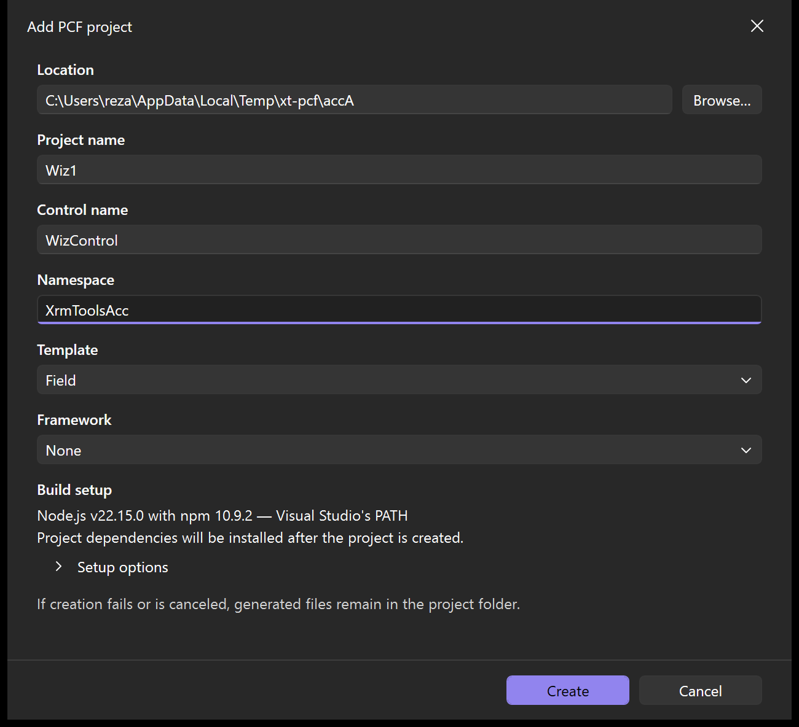

_Wizard with usable Node.js: one summary line, setup options collapsed_

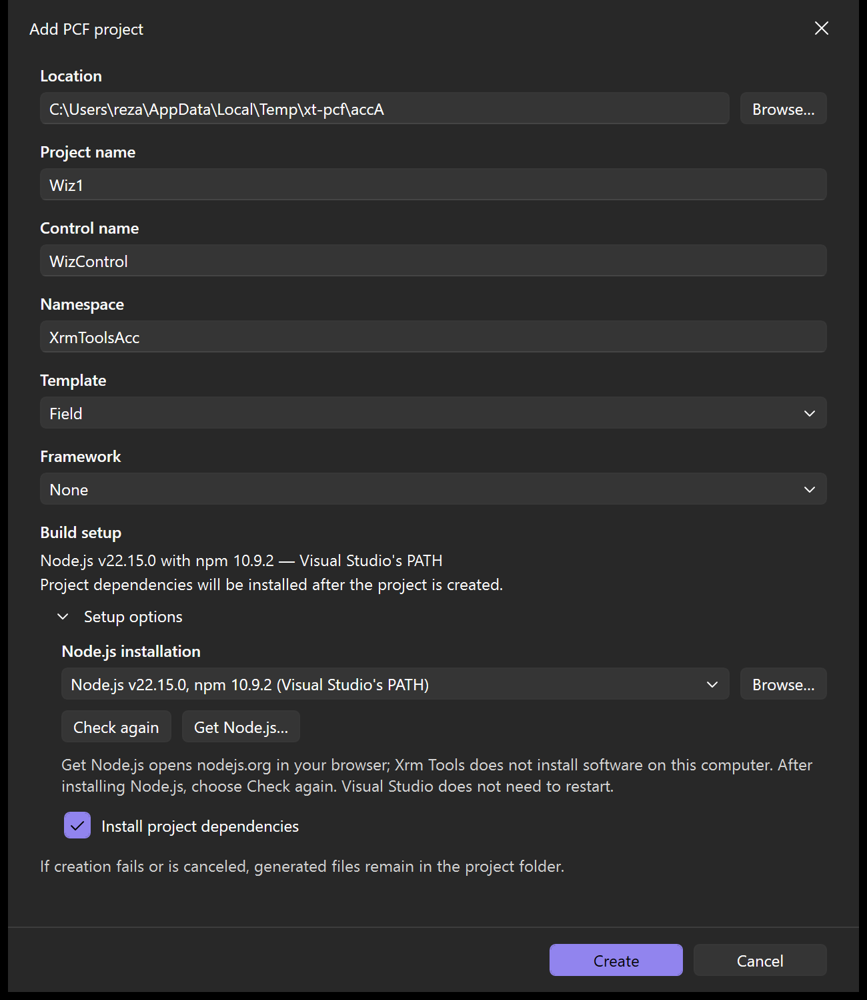

_Setup options opened_

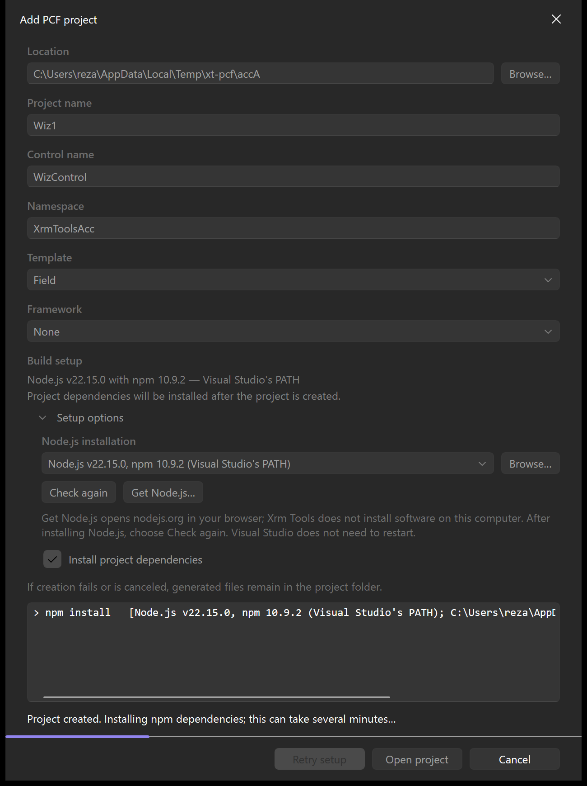

_Installing dependencies after creation_

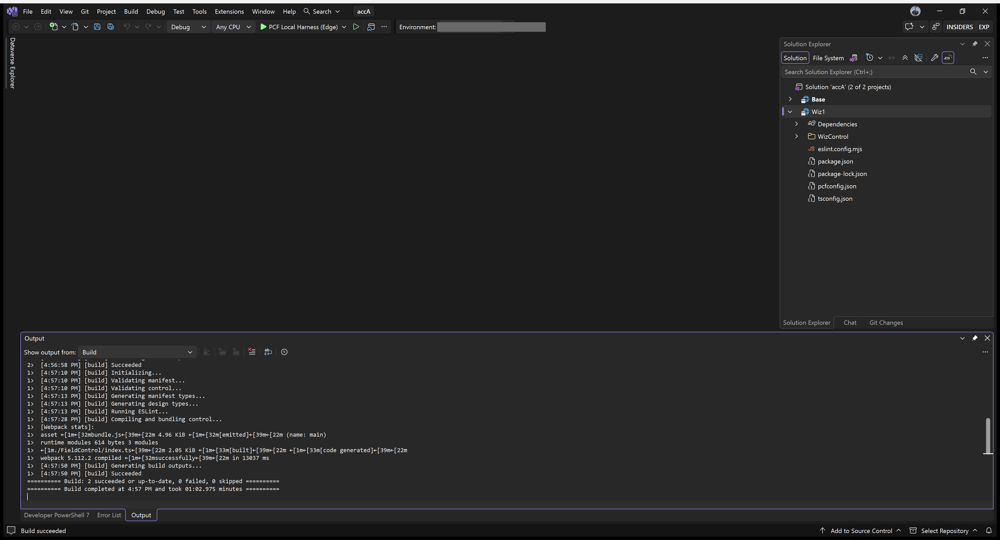

_Visual Studio after the first build_

### 2. fnm installed, Node.js and npm not on the inherited PATH

[02-fnm-without-node-on-path.log](pcf-build-setup-evidence/02-fnm-without-node-on-path.log)

```text
PATH given to Visual Studio: node.exe on it: False; npm on it: False; fnm on it: %USERPROFILE%\AppData\Local\Microsoft\WinGet\Packages\Schniz.fnm_Microsoft.Winget.Source_8wekyb3d8bbwe\fnm.exe
=== 2a: fnm has a default version; nothing to decide ===
REBUILD failedProjects=0 seconds=62; ========== Rebuild All: 1 succeeded, 0 failed, 0 skipped ==========
    1>  Xrm Tools: building 'Fnm2' with Node.js v22.15.0, npm 11.4.2 (fnm default) from %USERPROFILE%\AppData\Roaming\fnm\aliases\default
    1>  XTNODE Fnm2 v22.15.0 %USERPROFILE%\AppData\Roaming\fnm\aliases\default\node.exe
%USERPROFILE%\AppData\Local\Temp\xt-pcf\evidence\02a-build-with-fnm-default.png (1933x1045, 121 sampled colors)
=== 2b: fnm has two versions and no default; the build stops and Set up PCF build decides ===
REBUILD failedProjects=1 seconds=2; ========== Rebuild All: 0 succeeded, 1 failed, 0 skipped ==========
    1>%USERPROFILE%\AppData\Local\Temp\xt-pcf\acc2b\Choose2\Choose2.pcfproj : error XTPCF002: PCF project 'Choose2': fnm has several Node.js versions installed (v22.15.0, v24.21.0) and no default. Choose the version to use for this project. To do that, choose 'Set Up PCF Build' on the project's context menu.
notification: 'Choose2' cannot build: fnm has several Node.js versions installed (v22.15.0, v24.21.0) and no default.  Set up PCF build
%USERPROFILE%\AppData\Local\Temp\xt-pcf\evidence\02b-build-stopped-with-setup-action.png (3866x2090, 384 sampled colors)
setup dialog: summary='Node.js needs your attention before npm can run'
setup dialog: problem='fnm has several Node.js versions installed (v22.15.0, v24.21.0) and no default. Choose the version to use for this project.'
%USERPROFILE%\AppData\Local\Temp\xt-pcf\evidence\02c-setup-dialog-choose-version.png (1320x1070, 199 sampled colors)
selected in the dialog: Node.js v24.21.0, npm 11.19.0 (fnm)
setup dialog after selecting: summary='Node.js v24.21.0 with npm 11.19.0 — fnm'
setup dialog after Set up: status=''Choose2' is ready to build with Node.js v24.21.0.'
%USERPROFILE%\AppData\Local\Temp\xt-pcf\evidence\02d-setup-dialog-ready.png (1320x986, 265 sampled colors)
stored selection (%USERPROFILE%\AppData\Local\XrmTools\Pcf\node-selections.json): { "%USERPROFILE%\\APPDATA\\LOCAL\\TEMP\\XT-PCF\\ACC2B\\CHOOSE2\\CHOOSE2.PCFPROJ": { "NodeDirectory": "%USERPROFILE%\\AppData\\Local\\Temp\\xt-pcf\\fnmdir\\node-versions\\v24.21.0\\installation", "Version": "v24.21.0" } }
files added to the project folder by the selection: 0
REBUILD after setup failedProjects=0 seconds=60; ========== Rebuild All: 1 succeeded, 0 failed, 0 skipped ==========
    1>  Xrm Tools: building 'Choose2' with Node.js v24.21.0, npm 11.19.0 (selected for this project) from %USERPROFILE%\AppData\Local\Temp\xt-pcf\fnmdir\node-versions\v24.21.0\installation
    1>  XTNODE Choose2 v24.21.0 %USERPROFILE%\AppData\Local\Temp\xt-pcf\fnmdir\node-versions\v24.21.0\installation\node.exe
=== 2c: a new Visual Studio session remembers the selection; then the selected installation disappears ===
REBUILD in the new session failedProjects=0 seconds=34; ========== Rebuild All: 1 succeeded, 0 failed, 0 skipped ==========
    1>  XTNODE Choose2 v24.21.0 %USERPROFILE%\AppData\Local\Temp\xt-pcf\fnmdir\node-versions\v24.21.0\installation\node.exe
removed the selected installation's folder (exists now: False)
REBUILD after the installation disappeared failedProjects=1 seconds=2; ========== Rebuild All: 0 succeeded, 1 failed, 0 skipped ==========
    1>%USERPROFILE%\AppData\Local\Temp\xt-pcf\acc2b\Choose2\Choose2.pcfproj : error XTPCF002: PCF project 'Choose2': The Node.js installation selected for this project is no longer available (%USERPROFILE%\AppData\Local\Temp\xt-pcf\fnmdir\node-versions\v24.21.0\installation). Choose another installation. To do that, choose 'Set Up PCF Build' on the project's context menu.
```

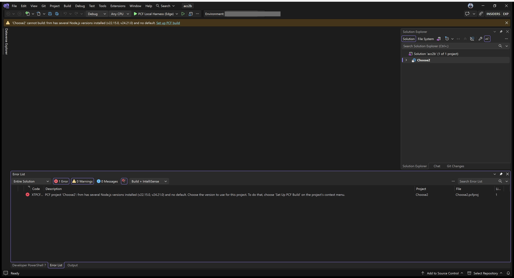

_Build stopped; Error List and the Set up PCF build notification_

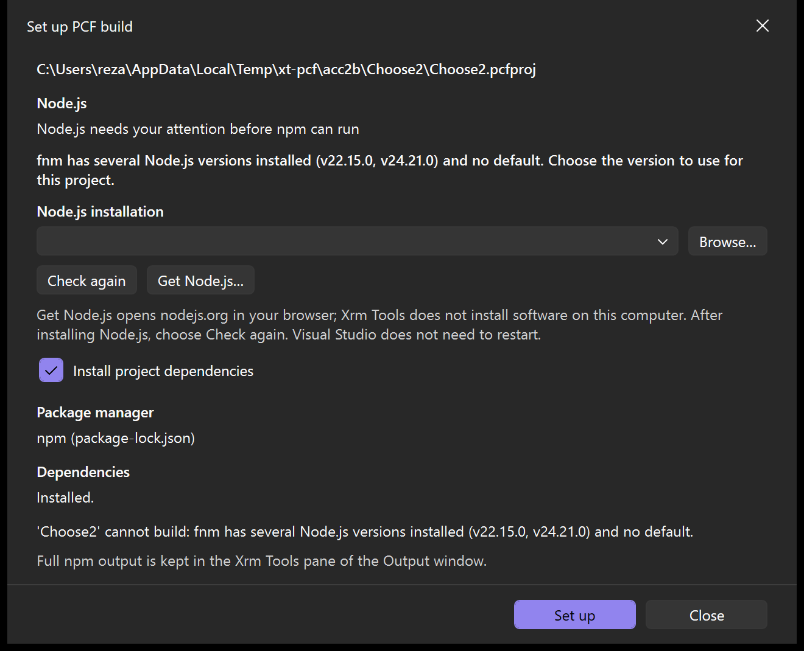

_Set up PCF build asking for a version_

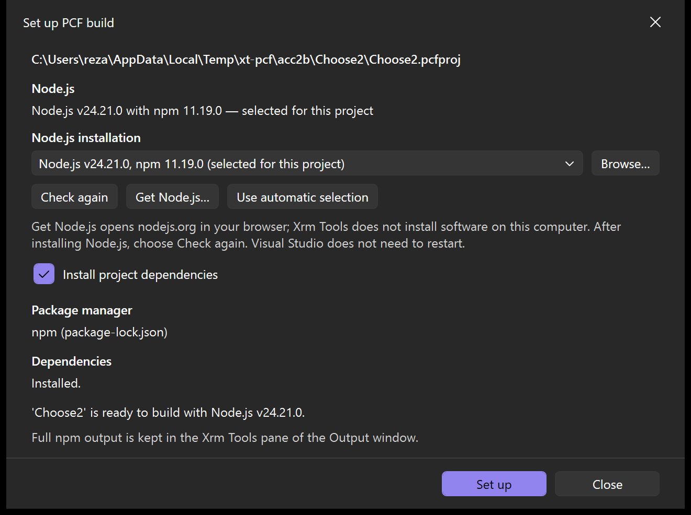

_After choosing v24.21.0_

### 3 and 4. Fresh checkout: first Build, and first Rebuild

[03-04-fresh-build-rebuild.log](pcf-build-setup-evidence/03-04-fresh-build-rebuild.log)

```text
=== acceptance 03: first Build of a fresh checkout (node_modules present: False; package-lock.json present: True) ===
FIRST BUILD failedProjects=0 seconds=70; ========== Build: 1 succeeded or up-to-date, 0 failed, 0 skipped ==========
    1>  added 537 packages, and audited 538 packages in 1m
    1>  > node -e "console.log('XTNODE Fresh3 ' + process.version + ' ' + process.execPath)" && pcf-scripts build ...
    1>  XTNODE Fresh3 v22.15.0 %USERPROFILE%\AppData\Local\Author Software\nvm\installs\v22.15.0\node.exe
  pcf-scripts installed: True; bundle.js produced: True; package-lock.json unchanged: True
  %USERPROFILE%\AppData\Local\Temp\xt-pcf\evidence\03-first-build.png (1933x1045, 121 sampled colors)
UNCHANGED BUILD AFTER failedProjects=0 seconds=2; ========== Build: 1 succeeded or up-to-date, 0 failed, 0 skipped ==========; npm install ran: False; pcf-scripts ran: False
=== acceptance 04: first Rebuild of a fresh checkout (node_modules present: False; package-lock.json present: True) ===
FIRST REBUILD failedProjects=0 seconds=77; ========== Rebuild All: 1 succeeded, 0 failed, 0 skipped ==========
    1>  Xrm Tools: npm dependencies are not installed yet; running Microsoft's npm restore before Clean.
    1>  added 537 packages, and audited 538 packages in 1m
    1>  > node -e "console.log('XTNODE Fresh4 ' + process.version + ' ' + process.execPath)" && pcf-scripts clean ...
    1>  XTNODE Fresh4 v22.15.0 %USERPROFILE%\AppData\Local\Author Software\nvm\installs\v22.15.0\node.exe
    1>  > node -e "console.log('XTNODE Fresh4 ' + process.version + ' ' + process.execPath)" && pcf-scripts build ...
    1>  XTNODE Fresh4 v22.15.0 %USERPROFILE%\AppData\Local\Author Software\nvm\installs\v22.15.0\node.exe
    1>  > node -e "console.log('XTNODE Fresh4 ' + process.version + ' ' + process.execPath)" && pcf-scripts rebuild ...
    1>  XTNODE Fresh4 v22.15.0 %USERPROFILE%\AppData\Local\Author Software\nvm\installs\v22.15.0\node.exe
  pcf-scripts installed: True; bundle.js produced: True; package-lock.json unchanged: True
  %USERPROFILE%\AppData\Local\Temp\xt-pcf\evidence\04-first-rebuild.png (1933x1045, 120 sampled colors)
UNCHANGED BUILD AFTER failedProjects=0 seconds=2; ========== Build: 1 succeeded or up-to-date, 0 failed, 0 skipped ==========; npm install ran: False; pcf-scripts ran: False
```

### 5. No Node.js installation

[05-no-node-installation.log](pcf-build-setup-evidence/05-no-node-installation.log)

```text
Visual Studio started without node, npm or fnm on PATH; the registered Windows PATH is replaced by the same value; fnm's directory has no installed versions
REBUILD failedProjects=1 seconds=2; ========== Rebuild All: 0 succeeded, 1 failed, 0 skipped ==========
    1>%USERPROFILE%\AppData\Local\Temp\xt-pcf\acc5\None5\None5.pcfproj : error XTPCF001: PCF project 'None5': Node.js was not found on Visual Studio's PATH, on the Windows PATH, or in fnm. Install Node.js (LTS), or choose an existing installation. To do that, choose 'Set Up PCF Build' on the project's context menu.
notification: 'None5' cannot build: Node.js was not found on Visual Studio's PATH, on the Windows PATH, or in fnm.  Set up PCF build
%USERPROFILE%\AppData\Local\Temp\xt-pcf\evidence\05a-build-stopped-node-missing.png (3866x2090, 386 sampled colors)
setup dialog: summary='Node.js needs your attention before npm can run'
setup dialog: problem='Node.js was not found on Visual Studio's PATH, on the Windows PATH, or in fnm. Install Node.js (LTS), or choose an existing installation.'
setup dialog: actions offered: Browse…, Check again, Get Node.js…
setup dialog: guidance='Get Node.js opens nodejs.org in your browser; Xrm Tools does not install software on this computer. After installing Node.js, choose Check again. Visual Studio does not need to restart.'
setup dialog after choosing Set up without Node.js: status='Node.js was not found on Visual Studio's PATH, on the Windows PATH, or in fnm. Install Node.js (LTS), or choose an existing installation.'
%USERPROFILE%\AppData\Local\Temp\xt-pcf\evidence\05b-setup-dialog-node-missing.png (1320x1102, 208 sampled colors)
wizard: summary='Node.js needs your attention before npm can run'
wizard: install='Project dependencies cannot be installed until Node.js is set up.'
wizard: setup options Expanded by itself; problem='Node.js was not found on Visual Studio's PATH, on the Windows PATH, or in fnm. Install Node.js (LTS), or choose an existing installation.'
wizard window: 1300x1582 px; Create button on screen: True
%USERPROFILE%\AppData\Local\Temp\xt-pcf\evidence\05c-wizard-node-missing.png (1300x1582, 418 sampled colors)
```

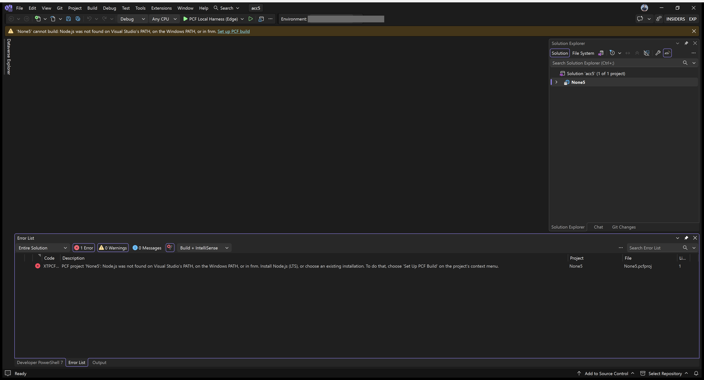

_Build stopped with XTPCF001 and the notification_

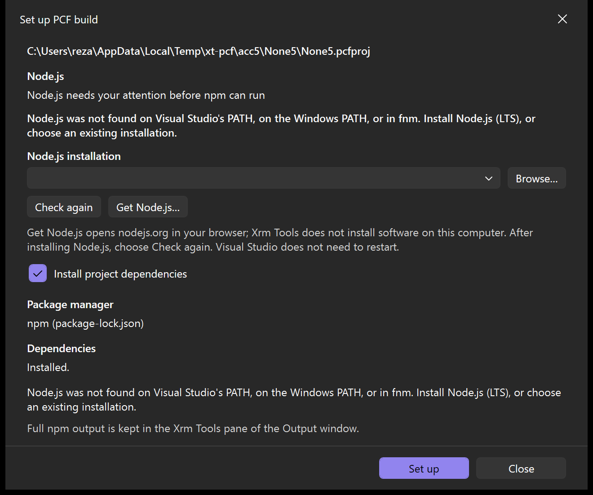

_Set up PCF build without Node.js_

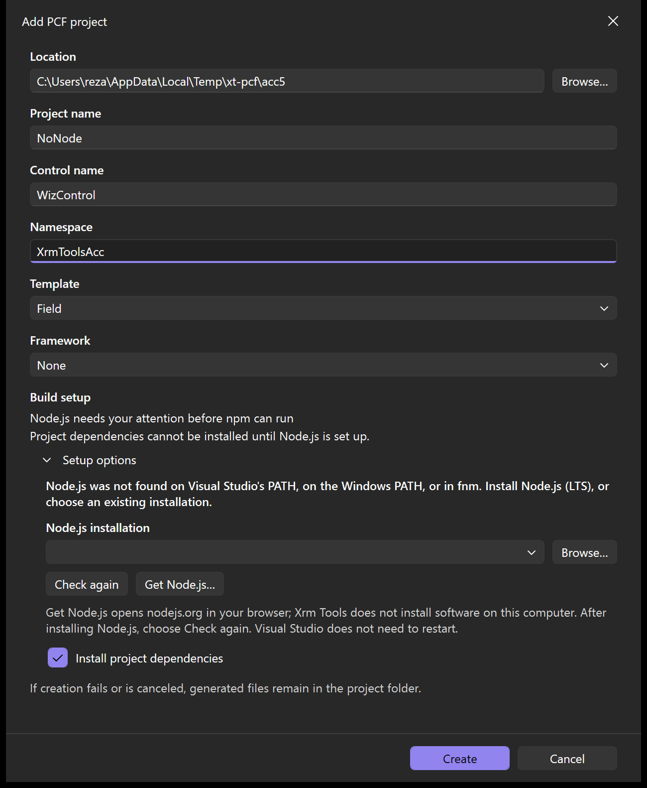

_Wizard without Node.js: setup options open by themselves_

### 6. Installation failure, kept project, retry after correction

[06-install-failure-and-retry.log](pcf-build-setup-evidence/06-install-failure-and-retry.log)

```text
Visual Studio 17240: normal PATH; user npm configuration: registry=http://127.0.0.1:9/; fetch-retries=0; 
=== 6a: install fails, the cause is corrected, Retry setup ===
status after the failed install: The project was created, but setup is incomplete. npm could not reach the registry (ECONNREFUSED). Check the network connection, proxy and registry settings in your npm configuration, then retry. Choose Retry setup, or open the project and set it up later.
buttons: Retry setup shown=True; Open project shown=True; Create shown=False
project kept: Wiz6a.pcfproj=True; pcf-scripts installed=False
npm output shown in the wizard (last lines): npm error code ECONNREFUSED | npm error syscall connect | npm error errno ECONNREFUSED
%USERPROFILE%\AppData\Local\Temp\xt-pcf\evidence\06a-wizard-install-failed.png (1300x1488, 430 sampled colors)
corrected the npm configuration; choosing Retry setup
after Retry setup: projects in solution=3; pcf-scripts installed=True
=== 6b: install fails, Open project, notification, Set up PCF build ===
status after the failed install: The project was created, but setup is incomplete. npm could not reach the registry (ECONNREFUSED). Check the network connection, proxy and registry settings in your npm configuration, then retry. Choose Retry setup, or open the project and set it up later.
Open project: projects in solution=4; notification: Setup for 'Wiz6b' is incomplete: its npm dependencies are not installed yet.  Set up PCF build
%USERPROFILE%\AppData\Local\Temp\xt-pcf\evidence\06b-opened-with-incomplete-setup-notification.png (3866x2090, 380 sampled colors)
corrected the npm configuration; choosing 'Set up PCF build' in the notification
setup dialog: dependencies='Not installed. Setup runs npm install, because the project has no package-lock.json yet.' status='Choose Set up to install the project's dependencies.'
%USERPROFILE%\AppData\Local\Temp\xt-pcf\evidence\06c-setup-dialog-incomplete.png (1320x986, 228 sampled colors)
setup dialog after Set up: dependencies='Installed.' status=''Wiz6b' is ready to build with Node.js v22.15.0.'
%USERPROFILE%\AppData\Local\Temp\xt-pcf\evidence\06d-setup-dialog-ready.png (1320x1270, 344 sampled colors)
notification still shown after setup: False
BUILD after recovery failedProjects=0 seconds=12; ========== Build: 4 succeeded or up-to-date, 0 failed, 0 skipped ==========; npm install ran: False; pcf-scripts ran: True
```

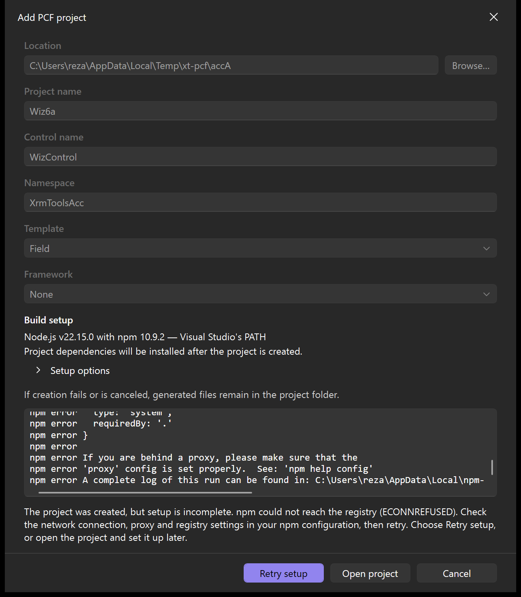

_Wizard after the failed install: Retry setup and Open project_

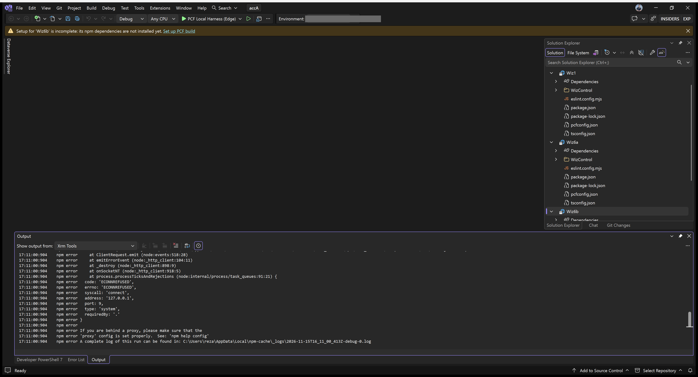

_Project opened with incomplete setup_

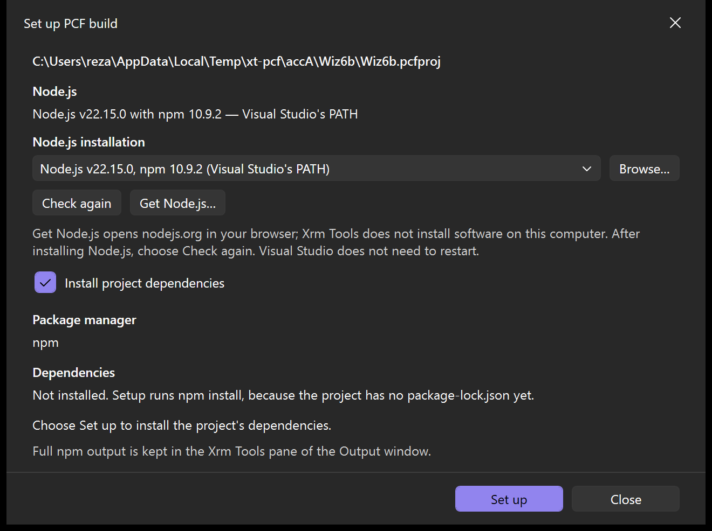

_Set up PCF build for that project_


_After Set up_

### 7. Cancellation

[07-cancel-and-retry.log](pcf-build-setup-evidence/07-cancel-and-retry.log)

```text
before: dependencies='Not installed. Setup runs npm ci, which installs exactly what package-lock.json lists.'
while installing: status='Installing npm dependencies; this can take several minutes…'; npm processes under Visual Studio: 2; setup lock files: 1; node_modules exists: True
%USERPROFILE%\AppData\Local\Temp\xt-pcf\evidence\07a-setup-installing.png (1320x1270, 350 sampled colors)
cancel completed within 4s: status='Setup was canceled. Dependencies may be only partly installed; run setup again to finish.'
after cancel: dependencies='Not installed. Setup runs npm ci, which installs exactly what package-lock.json lists.'; npm processes under Visual Studio: 0; setup lock files: 0; incomplete markers: 1; pcf-scripts present: False
%USERPROFILE%\AppData\Local\Temp\xt-pcf\evidence\07b-setup-canceled.png (1320x1270, 298 sampled colors)
after retry: dependencies='Installed.' status=''Fresh7' is ready to build with Node.js v22.15.0.'
after retry: setup lock files: 0; incomplete markers: 0; package-lock.json unchanged by npm ci: True
%USERPROFILE%\AppData\Local\Temp\xt-pcf\evidence\07c-setup-ready-after-retry.png (1320x1270, 346 sampled colors)
=== 7b: a second project's setup is canceled and then finished by Build instead of by setup ===
after cancel: status='Setup was canceled. Dependencies may be only partly installed; run setup again to finish.'; node_modules exists: True; pcf-scripts present: True; incomplete markers: 1
BUILD SOLUTION failedProjects=0 seconds=47; ========== Build: 2 succeeded or up-to-date, 0 failed, 0 skipped ==========
    2>  Xrm Tools: an earlier dependency install did not finish; running Microsoft's npm restore.
after the build: incomplete markers: 0; Fresh7b pcf-scripts present: True; bundle.js produced: True
UNCHANGED BUILD AFTER failedProjects=0 seconds=4; ========== Build: 2 succeeded or up-to-date, 0 failed, 0 skipped ==========; npm install ran: False; pcf-scripts ran: False
```

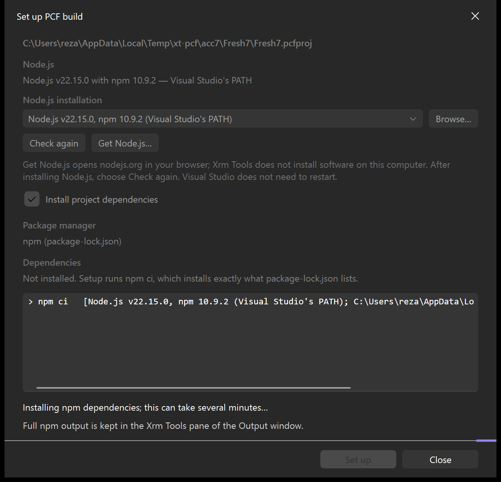

_Setup installing_

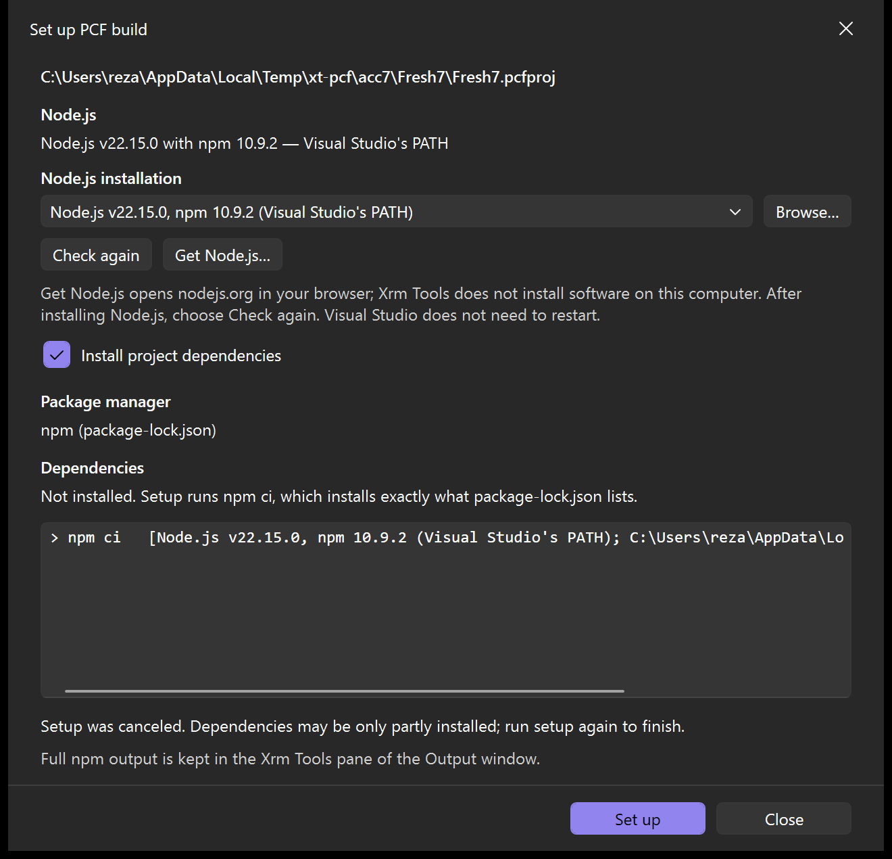

_After Cancel_

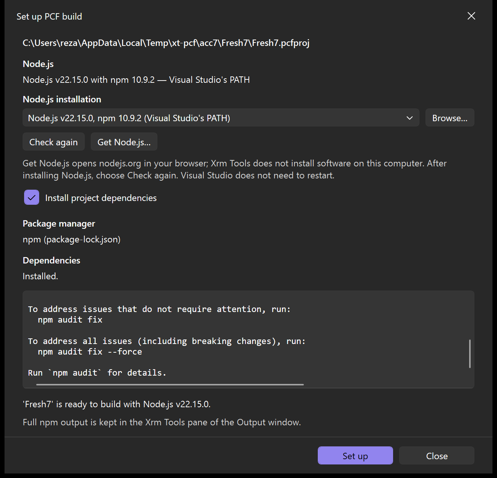

_After running setup again_

### 9. Concurrent setup and build for the same project

[09-concurrent-setup-and-build.log](pcf-build-setup-evidence/09-concurrent-setup-and-build.log)

```text
=== 9a: setup requested while a build is installing dependencies for the same project ===
build state when setup is requested: 2 (2 = in progress)
setup dialog during the build: dependencies='Not installed. Setup runs npm ci, which installs exactly what package-lock.json lists.'
Set up chosen during the build: status='A build is running. Wait for it to finish or cancel it, then retry setup.'; npm output box shown: False
%USERPROFILE%\AppData\Local\Temp\xt-pcf\evidence\09a-setup-refused-during-build.png (1320x986, 231 sampled colors)
REBUILD (not disturbed) failedProjects=0 seconds=131; ========== Rebuild All: 3 succeeded, 0 failed, 0 skipped ==========; 'added N packages' lines: 2, one for each of the two fresh projects
=== 9b: build requested while this Visual Studio's setup dialog is installing ===
setup running: status='Installing npm dependencies; this can take several minutes…'
20s after a Build.BuildSolution request from another process: request still waiting on Visual Studio: True; MSBuild or npm started by a build: False; setup still installing: True
setup finished undisturbed: dependencies='Installed.' status=''FreshA' is ready to build with Node.js v22.15.0.'
=== 9c: build requested while another Visual Studio process runs setup for the same project (its setup lock is held) ===
process 11976 holds %USERPROFILE%\AppData\Local\XrmTools\Pcf\setup\A4C211500DB7493227049807.lock, as a second Visual Studio running setup would
BUILD while the setup lock is held failedProjects=1 seconds=4; ========== Build: 2 succeeded or up-to-date, 1 failed, 0 skipped ==========
    3>%USERPROFILE%\AppData\Local\Temp\xt-pcf\acc9\FreshA\FreshA.pcfproj : error XTPCF006: PCF project 'FreshA': setup is still installing npm dependencies. Build again when setup has finished.
  FreshA node_modules touched by that build: False
  notification: Setup is still installing npm dependencies for 'FreshA'.  Set up PCF build
  %USERPROFILE%\AppData\Local\Temp\xt-pcf\evidence\09c-build-stopped-while-setup-runs.png (3866x2090, 386 sampled colors)
released the setup lock (lock file left behind: False)
BUILD after the lock was released failedProjects=0 seconds=73; ========== Build: 3 succeeded or up-to-date, 0 failed, 0 skipped ==========
    3>  added 537 packages, and audited 538 packages in 1m
```


_Setup refused while a build runs_

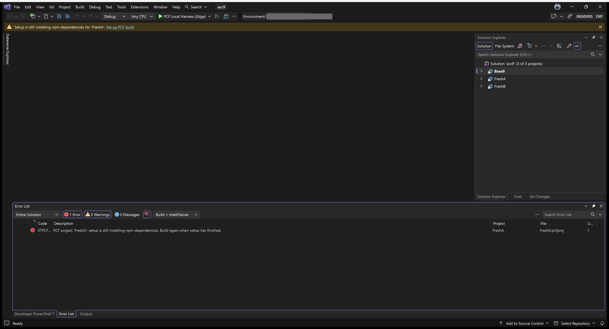

_Build stopped while another setup holds the project_

### 10. Two projects that need different Node.js versions

[10-different-node-requirements.log](pcf-build-setup-evidence/10-different-node-requirements.log)

```text
P22\.nvmrc = 22; P24\.nvmrc = 24; fnm has v22.15.0 and v24.21.0; no Node.js on Visual Studio's PATH
REBUILD SOLUTION, both projects loaded: failedProjects=1 seconds=74; ========== Rebuild All: 1 succeeded, 1 failed, 0 skipped ==========
    2>%USERPROFILE%\AppData\Local\Temp\xt-pcf\acc10\P24\P24.pcfproj : error XTPCF007: PCF project 'P24' needs Node.js v24.21.0, npm 11.19.0 (fnm, from .nvmrc), but this build is using Node.js v22.15.0, npm 11.4.2 (fnm, from .nvmrc) for 'P22'. One Visual Studio build can use only one Node.js installation. If the projects can share one, select it for each of them with 'Set Up PCF Build'; otherwise unload the other PCF projects before building this one, or open it in a separate Visual Studio window.
    1>  Xrm Tools: building 'P22' with Node.js v22.15.0, npm 11.4.2 (fnm, from .nvmrc) from %USERPROFILE%\AppData\Roaming\fnm\node-versions\v22.15.0\installation
    1>  XTNODE P22 v22.15.0 %USERPROFILE%\AppData\Roaming\fnm\node-versions\v22.15.0\installation\node.exe
  an npm script ran for P24 with any Node.js version: False
  notification: 'P24' needs a different Node.js version than the other PCF projects in this build.  Set up PCF build
  %USERPROFILE%\AppData\Local\Temp\xt-pcf\evidence\10a-one-project-stopped-with-limitation.png (3866x2090, 380 sampled colors)
unloaded P22 in the same Visual Studio session
REBUILD SOLUTION, P22 unloaded: failedProjects=0 seconds=57; ========== Rebuild All: 1 succeeded, 0 failed, 0 skipped ==========
    1>  Xrm Tools: building 'P24' with Node.js v24.21.0, npm 11.19.0 (fnm, from .nvmrc) from %USERPROFILE%\AppData\Roaming\fnm\node-versions\v24.21.0\installation
    1>  XTNODE P24 v24.21.0 %USERPROFILE%\AppData\Roaming\fnm\node-versions\v24.21.0\installation\node.exe
```

### 11. Project configured for another package manager

[11-other-package-manager.log](pcf-build-setup-evidence/11-other-package-manager.log)

```text
package.json declares: "packageManager": "pnpm@9.12.0", (pnpm and Yarn are also installed on this machine)
BUILD failedProjects=1 seconds=2; ========== Build: 0 succeeded or up-to-date, 1 failed, 0 skipped ==========
    1>%USERPROFILE%\AppData\Local\Temp\xt-pcf\acc11\Pnpm11\Pnpm11.pcfproj : error XTPCF004: PCF project 'Pnpm11' is configured for pnpm ("packageManager": "pnpm@9.12.0" in %USERPROFILE%\AppData\Local\Temp\xt-pcf\acc11\Pnpm11\package.json). Microsoft's PCF build installs dependencies with npm, which would add npm files to this project, so npm install was not run and no files were changed. Install dependencies with pnpm and set <PcfEnableAutoNpmInstall>false</PcfEnableAutoNpmInstall> in the project file so builds do not run npm install, then build again.
REBUILD failedProjects=1 seconds=2; ========== Rebuild All: 0 succeeded, 1 failed, 0 skipped ==========
    1>%USERPROFILE%\AppData\Local\Temp\xt-pcf\acc11\Pnpm11\Pnpm11.pcfproj : error XTPCF004: PCF project 'Pnpm11' is configured for pnpm ("packageManager": "pnpm@9.12.0" in %USERPROFILE%\AppData\Local\Temp\xt-pcf\acc11\Pnpm11\package.json). Microsoft's PCF build installs dependencies with npm, which would add npm files to this project, so npm install was not run and no files were changed. Install dependencies with pnpm and set <PcfEnableAutoNpmInstall>false</PcfEnableAutoNpmInstall> in the project file so builds do not run npm install, then build again.
project files unchanged: True; package-lock.json created: False; node_modules created: False
notification: 'Pnpm11' is configured for pnpm, so the build did not run npm install for it.  Set up PCF build
%USERPROFILE%\AppData\Local\Temp\xt-pcf\evidence\11a-build-stopped-other-package-manager.png (3866x2090, 383 sampled colors)
setup dialog: package manager='pnpm ("packageManager": "pnpm@9.12.0" in %USERPROFILE%\AppData\Local\Temp\xt-pcf\acc11\Pnpm11\package.json). Xrm Tools prepares npm projects only, so it will not run npm here and has not changed any file. Install dependencies with pnpm; to keep builds from running npm install, set PcfEnableAutoNpmInstall to false in the project file.'
setup dialog: dependencies='Not installed.' status='Node.js is ready. Install dependencies with pnpm, then build.'
after choosing Set up: status='Node.js is ready. Install dependencies with pnpm, then build.'; project files unchanged: True; node_modules created: False
%USERPROFILE%\AppData\Local\Temp\xt-pcf\evidence\11b-setup-dialog-other-package-manager.png (1320x1082, 249 sampled colors)
```

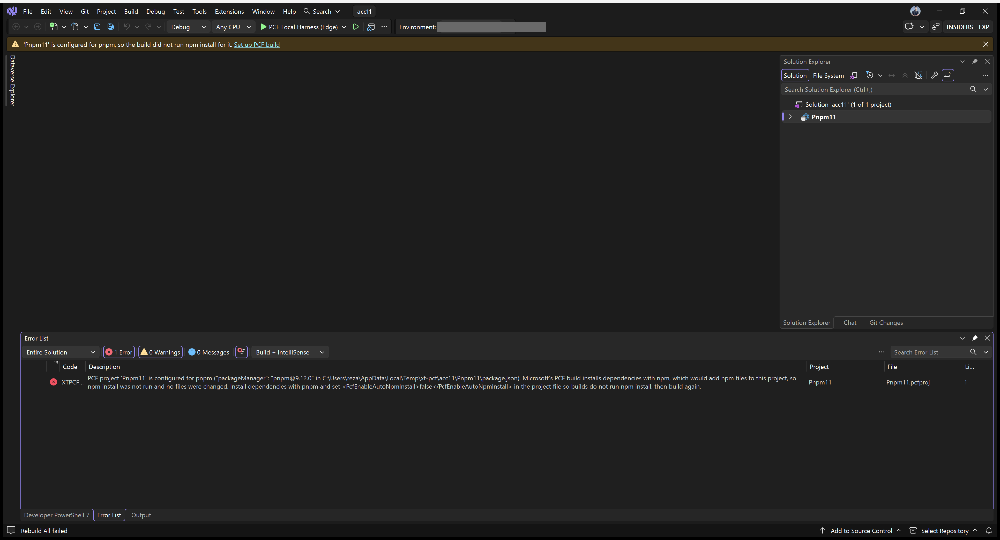

_Build stopped with XTPCF004_

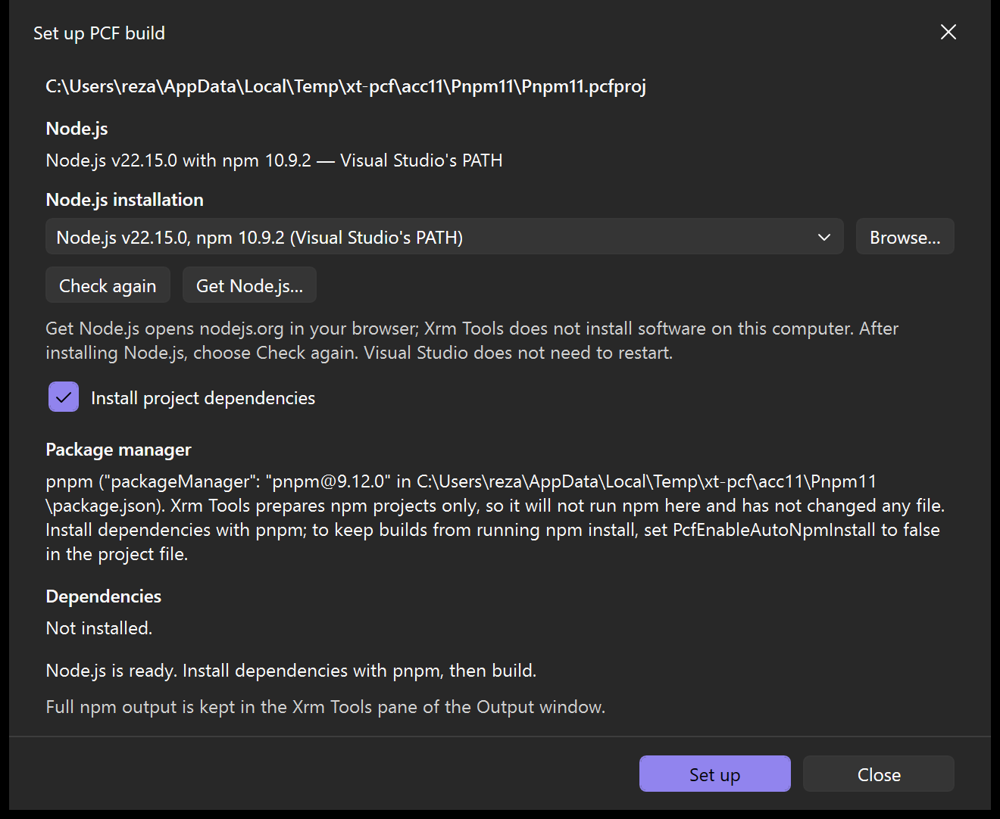

_Set up PCF build explains and installs nothing_

### 12. Relaunch (not required): the selection reaches every build node

[12-environment-propagation.log](pcf-build-setup-evidence/12-environment-propagation.log)

```text
Visual Studio 19284 started without Node.js on PATH and was not restarted; three PCF projects build in parallel; the stored selection for all three is rewritten before each build
build 1, selection v22.15.0 -> REBUILD failedProjects=0 seconds=74; ========== Rebuild All: 3 succeeded, 0 failed, 0 skipped ==========
    Node.js reported from inside Microsoft's npm scripts: XTNODE P1 v22.15.0; XTNODE P2 v22.15.0; XTNODE P3 v22.15.0
    XTPCF008 (build process saw another Node.js): False; MSBuild worker processes of this Visual Studio after the build: 1036, 16884, 18824
build 2, selection v24.21.0 -> REBUILD failedProjects=0 seconds=42; ========== Rebuild All: 3 succeeded, 0 failed, 0 skipped ==========
    Node.js reported from inside Microsoft's npm scripts: XTNODE P1 v24.21.0; XTNODE P2 v24.21.0; XTNODE P3 v24.21.0
    XTPCF008 (build process saw another Node.js): False; MSBuild worker processes of this Visual Studio after the build: 1036, 16884
build 3, selection v22.15.0 -> REBUILD failedProjects=0 seconds=38; ========== Rebuild All: 3 succeeded, 0 failed, 0 skipped ==========
    Node.js reported from inside Microsoft's npm scripts: XTNODE P1 v22.15.0; XTNODE P2 v22.15.0; XTNODE P3 v22.15.0
    XTPCF008 (build process saw another Node.js): False; MSBuild worker processes of this Visual Studio after the build: 1036, 16884, 22464
```

### Additional: Node.js newer than the Visual Studio session; local test harness

[13-windows-path-and-harness.log](pcf-build-setup-evidence/13-windows-path-and-harness.log)

```text
=== 13a: Visual Studio's own PATH has no Node.js; the registered Windows PATH does; no restart ===
REBUILD failedProjects=0 seconds=42; ========== Rebuild All: 1 succeeded, 0 failed, 0 skipped ==========
    1>  Xrm Tools: building 'WinPath' with Node.js v22.15.0, npm 10.9.2 (Windows PATH, newer than this Visual Studio session) from %USERPROFILE%\AppData\Local\Author Software\nvm\.nodejs
    1>  XTNODE WinPath v22.15.0 %USERPROFILE%\AppData\Local\Author Software\nvm\installs\v22.15.0\node.exe
=== 13b: Start Local Test Harness with fnm only (no Node.js on Visual Studio's PATH) ===
    17:51:03:479	Starting PCF local harness: %USERPROFILE%\AppData\Local\Temp\xt-pcf\acc2\Fnm2
    17:51:03:783	Starting PCF harness using %USERPROFILE%\AppData\Roaming\fnm\aliases\default\npm.cmd.
    17:51:34:782	 Local: http://localhost:8181
harness node process: %USERPROFILE%\AppData\Roaming\fnm\aliases\default\node.exe
harness node processes after Stop Local Test Harness: 0
```

### Additional: command-line build is unchanged

[14-command-line-build-unchanged.log](pcf-build-setup-evidence/14-command-line-build-unchanged.log)

```text
Command-line build with the generated targets file present (obj\None5.pcfproj.xrmtools.g.targets exists: True); MSBuild.exe None5.pcfproj -t:Rebuild, Node.js from the shell's PATH
exit code: 0; Build succeeded.
Xrm Tools targets that ran: 0; lines mentioning Xrm Tools or XTPCF: 0
Microsoft targets that ran: PcfClean, PcfBuild, PcfRebuild
```

